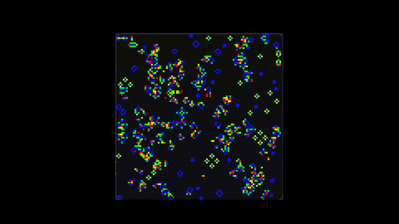

# Conway's Game of Life

A Python implementation of **Conway's Game of Life**, built with Pygame.

This project is a learning experience designed to improve my Python programming skills and get more familiar with Git and GitHub.



## Features

* Cellular automaton simulation based on Conway's Game of Life rules.
* Real-time visualization using Pygame.
* Pause and resume the simulation.
* Step through the simulation one generation at a time.

## Getting Started

### Requirements

* [Python 3](https://www.python.org/downloads/)
* [Pygame](https://www.pygame.org/)

### Installation

1. Clone this repository or download the source files.

2. Install the required dependency:

   ```bash
   python -m pip install pygame
   ```

3. Run the game:

   ```bash
   python game.py
   ```

## Controls

| Key           | Action                         |
| ------------- | ------------------------------ |
| `Space`       | Pause / resume the simulation  |
| `Right Arrow` | Advance to the next generation |

## About the Project

This is a personal learning project, so the current version is intentionally simple and does not include all the features I would like to implement in a more complete version.

I might improve it over time as I learn more about Python, game development, and software design.

Suggestions and feedback are welcome!

---

*Made with Python and Pygame.*
